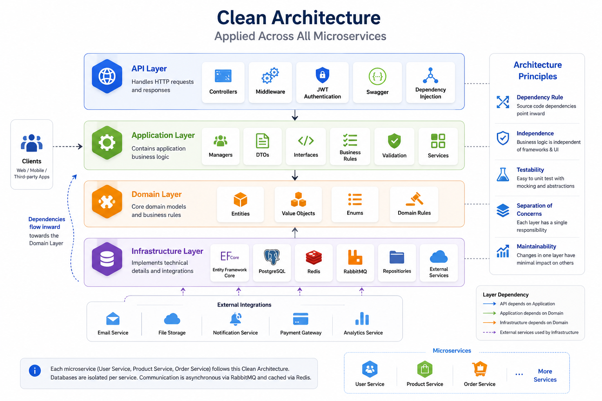
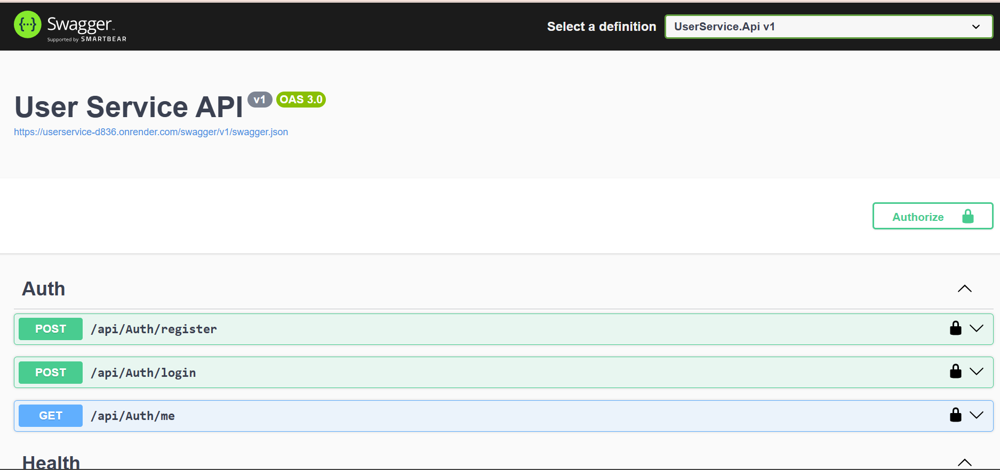
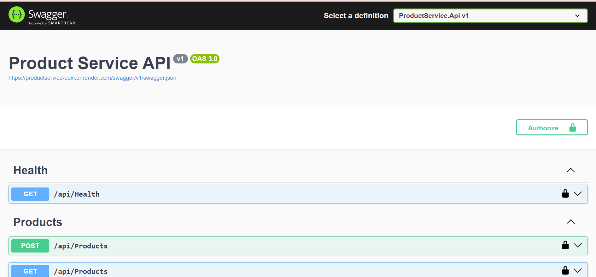
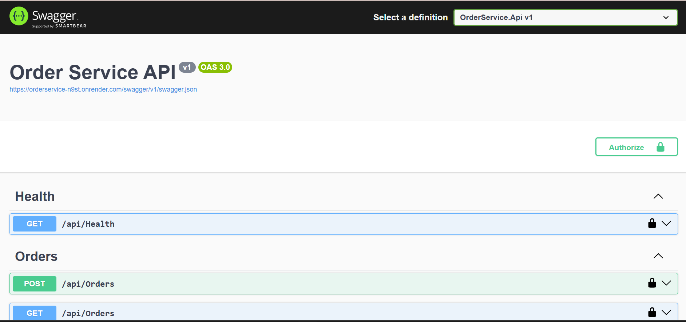
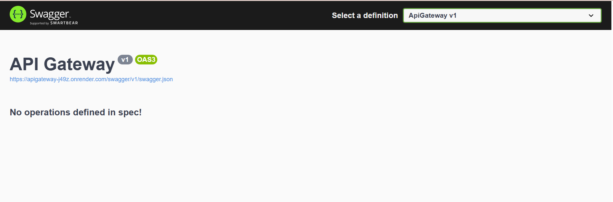
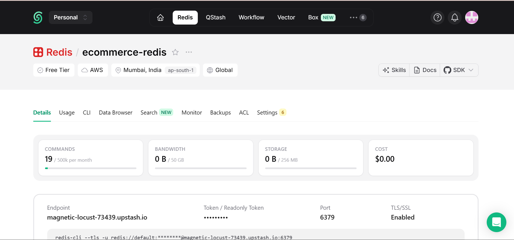
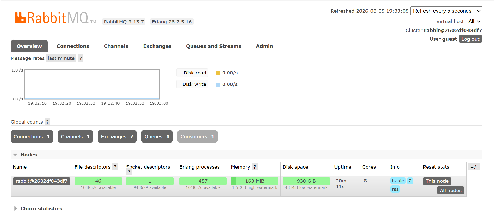
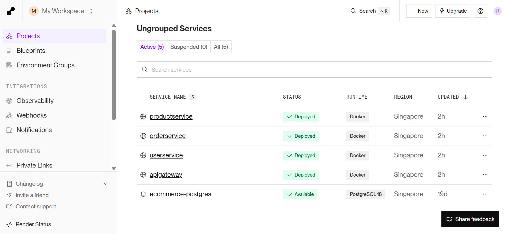
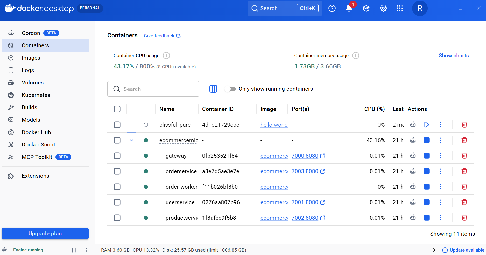
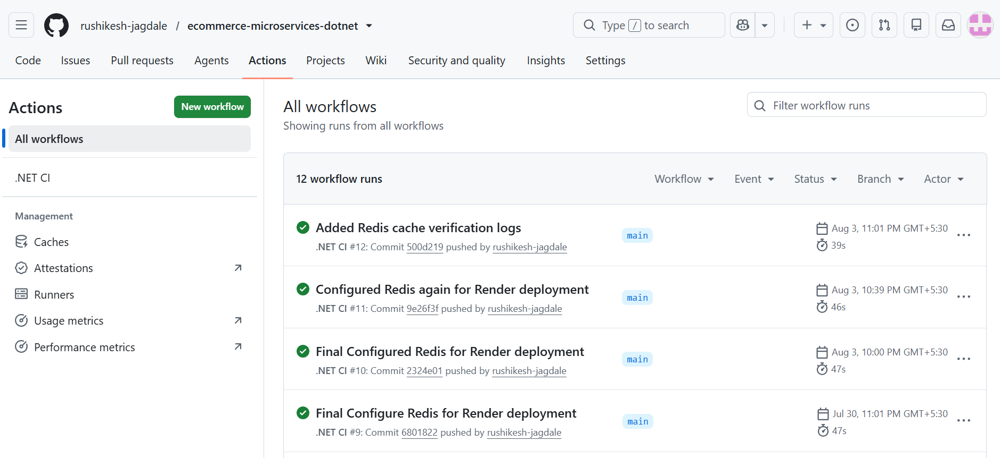

# 🚀 E-Commerce Microservices Platform


> > **Production-ready E-Commerce Backend built with ASP.NET Core 8, Clean Architecture, Microservices, Docker, RabbitMQ, Redis, API Gateway (Ocelot), SQL Server (Local Development), PostgreSQL (Cloud), and GitHub Actions CI/CD.**

## 🌐 Live API Documentation

| Service | Live Swagger |
|---------|--------------|
| API Gateway | https://apigateway-j49z.onrender.com/swagger/index.html |
| User Service | https://userservice-d836.onrender.com/swagger/index.html |
| Product Service | https://productservice-eoxi.onrender.com/swagger/index.html |
| Order Service | https://orderservice-n9st.onrender.com/swagger/index.html |

## 📖 Project Overview

This project is a production-ready **E-Commerce Backend** built using a **Microservices Architecture** with **ASP.NET Core 8**.

The solution demonstrates how modern distributed applications are designed by separating business capabilities into independent services that communicate through REST APIs and asynchronous messaging using RabbitMQ.

The platform includes dedicated services for **User Management**, **Product Management**, and **Order Management**, all exposed through an **API Gateway**. Each service follows **Clean Architecture** principles with separate Domain, Application, Infrastructure, and API layers.

The project also demonstrates enterprise-level concepts including:

* API Gateway using Ocelot
* JWT Authentication & Authorization
* RabbitMQ Event-Driven Communication
* Redis Distributed Caching
* Docker Containerization
* GitHub Actions Continuous Integration (CI)
* Repository Pattern
* Dependency Injection
* Global Exception Handling
* Request Logging
* Unit Testing using xUnit & Moq

This repository was built to simulate a real-world backend architecture and serves as a comprehensive portfolio project demonstrating modern backend engineering practices.

## ✨ Features

### 🔐 Authentication & Authorization

- User Registration
- User Login
- JWT Authentication
- Role-Based Authorization (Admin/User)
- Secure Password Hashing using BCrypt

---

### 🚪 API Gateway (Ocelot)

- Single Entry Point
- Request Routing
- Centralized API Access
- Simplified Client Communication

---

### 📦 Product Service

- Create Product
- Update Product
- Delete Product
- Get Product by ID
- Get Products with Pagination
- Product Search
- Category Filtering
- Stock Quantity Management

---

### 🛒 Order Service

- Create Orders
- Order Status Tracking
- Product Stock Validation
- Automatic Stock Reduction
- Order History

---

### 📨 Event-Driven Communication

- RabbitMQ Integration
- Asynchronous Messaging
- Order Created Event Publishing
- Background Worker Processing
- Loose Coupling Between Services

---

### ⚡ Redis Caching

- Upstash Redis Integration
- Product Lookup Caching
- Automatic Cache Expiration
- Cache Invalidation after Update/Delete
- Improved API Performance

---

### 🗄️ Database

- PostgreSQL
- Entity Framework Core
- Code First Migrations
- Database-per-Service Pattern

---

### 📊 Logging & Monitoring

- Serilog Integration
- Structured Logging
- Request Logging
- Exception Logging
- Redis Cache Hit/Miss Logs
- ASP.NET Core Health Checks
- PostgreSQL Health Check
- Service Monitoring Endpoints

---

### 🛡️ Security

- JWT Bearer Authentication
- Protected Admin Endpoints
- Role-Based Access Control
- Secure API Communication

---

### ☁️ Cloud Deployment

- Render Deployment
- PostgreSQL Cloud Database
- Upstash Redis
- GitHub Integration
- Continuous Deployment

---

### 🏗️ Architecture

- Microservices Architecture
- Clean Architecture
- Repository Pattern
- Dependency Injection
- Service Separation
- RESTful APIs


## 🏗️ Architecture

The application follows a **Microservices Architecture** built with **ASP.NET Core 8**, where each service owns its own database and business logic.

```
                    +----------------------+
                    |      Client          |
                    +----------+-----------+
                               |
                               |
                     HTTPS Requests
                               |
                     +---------v---------+
                     |    API Gateway    |
                     |      (YARP)       |
                     +----+---------+----+
                          |         |
          ----------------+---------+----------------
          |               |         |               |
          |               |         |               |
+---------v-----+ +-------v------+ +-------v--------+
| User Service  | | Product      | | Order Service  |
| Authentication| | Service      | | Order Mgmt     |
| JWT           | | Catalog      | | Purchase Flow  |
+---------+-----+ +-------+------+ +-------+--------+
          |               |                |
          |               |                |
   PostgreSQL      PostgreSQL      PostgreSQL
          |               |
          |               |
          |         +-----v------+
          |         |   Redis    |
          |         |  Upstash   |
          |         +------------+

                 Centralized Logging
                     Serilog
```

### 🏛️ Architectural Principles

| Principle | Implementation |
|-----------|----------------|
| **Microservices** | Independent services for User, Product, and Order domains |
| **Clean Architecture** | Domain, Application, Infrastructure, and API layers |
| **Database-per-Service** | Each service owns its own PostgreSQL database |
| **API Gateway** | Ocelot routes all client requests |
| **Event-Driven Communication** | RabbitMQ enables asynchronous messaging |
| **Distributed Caching** | Upstash Redis caches frequently accessed data |
| **Containerization** | Docker Compose orchestrates all services locally |

### Components

#### API Gateway

* Single entry point for clients
* Routes requests to appropriate microservices
* Simplifies client communication

#### User Service

Responsible for:

* User Registration
* User Login
* JWT Authentication
* Role Management

Database:

* PostgreSQL

---

#### Product Service

Responsible for:

* Product CRUD
* Product Search
* Product Inventory
* Redis Caching

Database:

* PostgreSQL

Cache:

* Upstash Redis

---

#### Order Service

Responsible for:

* Order Creation
* Order Tracking
* Stock Validation
* Communication with Product Service

Database:

* PostgreSQL

---

#### PostgreSQL

Each microservice owns its own PostgreSQL database following the Database-per-Service pattern.

---

#### Redis (Upstash)

Used for:

* Product caching
* Faster product retrieval
* Reduced PostgreSQL load
* Improved API response time

---

#### Order Processor Worker

Handles:

- RabbitMQ Event Consumption
- Background Order Processing
- Asynchronous Task Execution

**Messaging:** RabbitMQ

#### Serilog

Provides centralized structured logging for:

* API Requests
* Cache Hits/Misses
* Exceptions
* Database Operations

## ☁️ Cloud Deployment

The platform is deployed on cloud infrastructure using Render, PostgreSQL, and Upstash Redis.

### 🌍 Live Deployment

| Service | Platform | Status |
|---------|----------|--------|
| API Gateway | Render | ✅ Live |
| User Service | Render | ✅ Live |
| Product Service | Render | ✅ Live |
| Order Service | Render | ✅ Live |
| PostgreSQL Databases | Render PostgreSQL | ✅ Live |
| Redis Cache | Upstash Redis | ✅ Live |

### 🔗 Live Endpoints

| Service | URL |
|---------|-----|
| API Gateway | https://apigateway-j49z.onrender.com/swagger/index.html |
| User Service | https://userservice-d836.onrender.com/swagger/index.html |
| Product Service | https://productservice-eoxi.onrender.com/swagger/index.html |
| Order Service | https://orderservice-n9st.onrender.com/swagger/index.html |

### Deployment Architecture

                    Internet
                        │
                        ▼
                API Gateway (Render)
                        │
        ┌───────────────┼───────────────┐
        ▼               ▼               ▼
 User Service     Product Service   Order Service
   (Render)          (Render)         (Render)
        │               │               │
 PostgreSQL      PostgreSQL      PostgreSQL
   (Render)         (Render)         (Render)

              Product Service
                    │
                    ▼
            Upstash Redis Cache

          RabbitMQ → Order Worker

### 🚀 Deployment Highlights

- Independent deployment of each microservice
- Managed PostgreSQL databases on Render
- Distributed caching with Upstash Redis
- Environment-based configuration
- Public Swagger documentation for all services
- Automatic deployments from GitHub
- Health monitoring endpoints

## ⚡ Redis Distributed Caching

> The Product Service implements the **Cache-Aside Pattern**, where Redis is checked before querying PostgreSQL. On a cache miss, data is retrieved from the database, stored in Redis, and returned to the client. This strategy reduces database load while maintaining data consistency through cache invalidation.

### Cache Flow

                 Client Request
                        │
                        ▼
                 Check Redis Cache
                 ┌────────┴────────┐
                 │                 │
           Cache HIT         Cache MISS
                 │                 │
                 ▼                 ▼
         Return Cached Data   Query PostgreSQL
                                   │
                                   ▼
                           Store Result in Redis
                                   │
                                   ▼
                            Return Response

### Caching Strategy

- Cache-Aside Pattern implementation
- Product lookup caching
- Automatic cache expiration (TTL)
- Cache invalidation after product updates
- Cache invalidation after product deletion
- Distributed cloud caching with Upstash Redis

### Verified Cache Behavior

Cache MISS
→ Product loaded from PostgreSQL
→ Product saved to Redis

Cache HIT
→ Product returned directly from Redis

This reduces database queries and significantly improves API performance.

## 📨 Event-Driven Communication

The platform uses **RabbitMQ** to enable **asynchronous, event-driven communication** between microservices. Instead of making direct synchronous calls for background operations, services publish events that are processed independently, resulting in better scalability, resilience, and loose coupling.

### Event Flow

                   Client
                      │
                      ▼
               Order Service
                      │
          Publish OrderCreated Event
                      │
                      ▼
                  RabbitMQ
                      │
                      ▼
          Order Processor Worker
                      │
          ┌───────────┴───────────┐
          ▼                       ▼
   Background Processing   Future Integrations
                            (Email, Notifications,
                             Inventory, Payments)

### Event Processing Flow

1. The client submits a new order.
2. The Order Service validates and stores the order.
3. An **OrderCreated** event is published to RabbitMQ.
4. The Order Processor Worker consumes the event asynchronously.
5. Background tasks are executed without delaying the API response.
6. The architecture can be extended to support notifications, payment processing, inventory updates, and other event-driven workflows.

### Benefits

- Loose coupling between services
- Improved scalability through asynchronous processing
- Faster API responses by offloading background tasks
- Easier integration of additional consumers without modifying existing services
- Better support for future event-driven features

## 📦 Services

### API Gateway

* Central entry point
* Request routing
* Authentication forwarding
* Swagger support

---

### User Service

Responsible for:

* User Registration
* Login
* JWT Authentication
* Authorization
* User Management

---

### Product Service

Responsible for:

* Product CRUD
* Inventory
* Product Search
* Stock Management

---

### Order Service

Responsible for:

* Order Creation
* Order Tracking
* Stock Validation
* Publishing Order Events

---

### Order Processor Worker

Responsible for:

* Consuming RabbitMQ Events
* Processing Orders
* Background Tasks

---

### Redis

Responsible for:

* Product Caching
* Faster API Responses

---

### RabbitMQ

Responsible for:

* Event-Driven Communication
* Decoupled Services
* Background Processing

## 🛠 Technology Stack

### Backend 

* ASP.NET Core 8 Web API
* C#
* .NET 8
* Clean Architecture
* RESTful APIs
* Entity Framework Core
* Dependency Injection
* Middleware
* Mapster (Object Mapping)

---

### Database

- SQL Server (Local Development)
- PostgreSQL (Cloud Deployment)
- Entity Framework Core Migrations

---

### Caching

* Upstash Redis
* Microsoft.Extensions.Caching.StackExchangeRedis

---

### 🚪 API Gateway

- Ocelot API Gateway
- Centralized Request Routing
- Reverse Proxy

---

### Authentication & Security

* JWT Authentication
* Role-Based Authorization
* BCrypt Password Hashing

---

### 📨 Messaging

- RabbitMQ
- RabbitMQ.Client
- Background Worker Service
- Event-Driven Communication

---

### Logging & Monitoring

* Serilog
* ASP.NET Core Health Checks

---

### Containerization

* Docker
* Docker Compose

---

### CI/CD

* GitHub Actions

---

### Testing

* xUnit
* FluentAssertions
* Moq

---

### Cloud & Deployment

* Render
* PostgreSQL Cloud Database
* Upstash Redis

---

### Development Tools

* Visual Studio 2022
* Swagger / OpenAPI
* Postman
* Git
* GitHub


## 📁 Project Structure

```text
ECommerce.Microservices
│
├── ApiGateway
│   ├── Middleware
│   ├── ocelot.json
│   └── Program.cs
│
├── UserService
│   ├── UserService.Api
│   ├── UserService.Application
│   ├── UserService.Domain
│   └── UserService.Infrastructure
│
├── ProductService
│   ├── ProductService.Api
│   ├── ProductService.Application
│   ├── ProductService.Domain
│   ├── ProductService.Infrastructure
│   └── ProductService.Tests
│
├── OrderService
│   ├── OrderService.Api
│   ├── OrderService.Application
│   ├── OrderService.Domain
│   ├── OrderService.Infrastructure
│   └── OrderService.Tests
│
├── OrderProcessor.Worker
│
├── Shared.Common
│
├── docker-compose.yml
│
└── ECommerce.Microservices.sln
```

### 📚 Layer Responsibilities

| Layer | Responsibility |
|-------|----------------|
| **API** | Controllers, Middleware, Dependency Injection, Swagger Configuration, Request Validation |
| **Application** | Business Logic, DTOs, Interfaces, Application Services, CQRS Handlers (if applicable) |
| **Domain** | Entities, Enums, Domain Models, Business Rules |
| **Infrastructure** | Entity Framework Core, Repositories, Database Access, External Integrations |
| **Shared.Common** | Shared Models, Common Responses, Exceptions, Utility Classes |
| **ApiGateway** | Ocelot Configuration, Request Routing, Centralized Entry Point |
| **OrderProcessor.Worker** | RabbitMQ Consumer, Background Processing, Event Handling |

> **Note:** Each microservice follows the same Clean Architecture structure (API, Application, Domain, and Infrastructure), ensuring consistency, maintainability, and independent development across the solution.

## 🚀 Getting Started

> ⚡ **Quick Start:** Want to explore the project without local setup? Visit the **Live API Documentation** section above to access the deployed services on Render.

### Prerequisites

Before running the project, ensure the following tools are installed:

| Tool               | Version         |
| ------------------ | --------------- |
| .NET SDK           | 8.0+            |
| Visual Studio      | 2022            |
| SQL Server         | 2022 or LocalDB |
| Docker Desktop     | Latest          |
| Git                | Latest          |
| Postman (Optional) | Latest          |

---

### Choose Your Setup

The project can be run in two ways:

- **Local Development** using Docker Compose and PostgreSQL
- **Cloud Deployment** using the live services hosted on Render

## Clone the Repository

```bash
git clone https://github.com/rushikesh-jagdale/ecommerce-microservices-dotnet.git

cd ecommerce-microservices-dotnet
```

---

## Restore Dependencies

```bash
dotnet restore
```

---

## Build the Solution

```bash
dotnet build
```

---

## Run Unit Tests

```bash
dotnet test
```

---

## Run Using Visual Studio

1. Open **ECommerce.Microservices.sln**
2. Set multiple startup projects.
3. Start:

   * UserService.Api
   * ProductService.Api
   * OrderService.Api
   * ApiGateway
4. Run the solution (F5).

---

## Run Using Docker

Build and start all services:

```bash
docker compose up --build
```

Run in detached mode:

```bash
docker compose up -d
```

Stop all services:

```bash
docker compose down
```

---

### ✅ Expected Startup

Once all services are running successfully:

- API Gateway becomes the primary entry point.
- Each microservice exposes its own Swagger UI.
- RabbitMQ processes asynchronous events.
- Redis caches product data.
- PostgreSQL stores service-specific data.

You can verify everything is working by opening the live or local Swagger endpoints.

---

## Default Admin Account

Use the seeded administrator account to test the APIs.

| Email                                             | Password  |
| ------------------------------------------------- | --------- |
| [admin@ecommerce.com](mailto:admin@ecommerce.com) | Admin@123 |

> After logging in, copy the JWT token from the login response and use it as a **Bearer Token** in Postman or Swagger for protected endpoints.

## 📬 API Reference

The platform exposes all APIs through the **API Gateway (Ocelot)**, providing a single entry point for all client requests.

> **Gateway Base URL**
>
> ```text
> http://localhost:7000
> ```

---

### 🔑 Authentication Legend

| Icon | Description |
|------|-------------|
| 🔓 | Public Endpoint |
| 🔒 | Requires JWT Authentication |
| 👑 | Requires Admin Role |

---

### 👤 User Service

| Method | Endpoint | Auth | Description |
|--------|----------|------|-------------|
| POST | `/gateway/auth/register` | 🔓 | Register a new user |
| POST | `/gateway/auth/login` | 🔓 | Authenticate user and receive a JWT token |
| GET | `/gateway/auth/me` | 🔒 | Retrieve the authenticated user's profile |

---

### 📦 Product Service

| Method | Endpoint | Auth | Description |
|--------|----------|------|-------------|
| GET | `/gateway/products` | 🔓 | Get paginated products |
| GET | `/gateway/products/{id}` | 🔓 | Get product by ID |
| POST | `/gateway/products` | 👑 | Create a new product |
| PUT | `/gateway/products/{id}` | 👑 | Update an existing product |
| DELETE | `/gateway/products/{id}` | 👑 | Delete a product |

---

### 🛒 Order Service

| Method | Endpoint | Auth | Description |
|--------|----------|------|-------------|
| POST | `/gateway/orders` | 🔒 | Create a new order |
| GET | `/gateway/orders` | 🔒 | Retrieve the authenticated user's orders |
| GET | `/gateway/orders/{id}` | 🔒 | Get order details |
| PUT | `/gateway/orders/{id}/status` | 👑 | Update the order status |

---

## 🔐 Authentication

Protected endpoints require a valid JWT access token.

**Authorization Header**

```text
Authorization: Bearer <your-jwt-token>
```

Generate a JWT token by calling:

```text
POST /gateway/auth/login
```

---

## 📖 Swagger Documentation

For interactive API testing, use the Swagger UI exposed by each service.

| Service | Local URL |
|---------|-----------|
| API Gateway | http://localhost:7000/swagger |
| User Service | http://localhost:7001/swagger |
| Product Service | http://localhost:7002/swagger |
| Order Service | http://localhost:7003/swagger |

> **Note:** The deployed Swagger endpoints for all services are available in the **🌐 Live API Documentation** section at the beginning of this README.

## 🔄 CI/CD Pipeline

This project implements a modern **CI/CD workflow** using **GitHub Actions** for Continuous Integration (CI) and **Render Auto Deploy** for Continuous Deployment (CD). Every code change is automatically validated and deployed, enabling a streamlined development workflow.

---

### 🔄 CI/CD Workflow

```text
Developer Pushes Code
          │
          ▼
GitHub Repository
          │
          ├──────────────┐
          ▼              ▼
 GitHub Actions (CI)   Render Auto Deploy (CD)
          │              │
          ├── Restore    ├── Detect New Commit
          ├── Build      ├── Build Services
          ├── Test       └── Deploy to Production
          └── Validate
```

---

### ✅ Continuous Integration (CI)

Every push or pull request to the **main** branch automatically:

- Restores NuGet packages
- Builds the complete solution
- Executes all unit tests
- Validates the codebase
- Reports workflow status in GitHub Actions

---

### 🚀 Continuous Deployment (CD)

Render is connected directly to the GitHub repository and automatically deploys the latest version of the application whenever changes are pushed to the **main** branch.

The deployment includes:

- API Gateway
- User Service
- Product Service
- Order Service

---

### ✨ Benefits

- Automated build validation
- Automatic deployment after code changes
- Early detection of build and test failures
- Consistent deployments from GitHub
- Faster and more reliable release process
- Reduced manual deployment effort

---

### 📌 Current Status

| Stage | Status |
|--------|--------|
| Continuous Integration (GitHub Actions) | ✅ Implemented |
| Continuous Deployment (Render Auto Deploy) | ✅ Implemented |

## 🐳 Docker & Containerization

The complete application runs inside Docker containers using **Docker Compose**.

Each microservice is isolated inside its own container and communicates through the internal Docker network.

### 📦 Container Overview

| Container | Purpose |
|-----------|---------|
| API Gateway | Central entry point for all client requests |
| User Service | Authentication & User Management |
| Product Service | Product Catalog & Inventory |
| Order Service | Order Management |
| Order Processor Worker | RabbitMQ Background Consumer |
| PostgreSQL | Database-per-Service persistent storage |
| RabbitMQ | Event-Driven Messaging |
| Redis | Distributed Caching |

### 🏗️ Docker Compose Services

The Docker Compose configuration provisions the complete development environment, including:

- API Gateway
- User Service
- Product Service
- Order Service
- Order Processor Worker
- PostgreSQL
- RabbitMQ
- Redis

All services are connected through an isolated Docker network, enabling seamless inter-service communication.

### Start All Services

```bash
docker compose up --build
```

---

### Stop All Services

```bash
docker compose down
```

---

### 🌐 Docker Networking

Docker Compose creates an isolated bridge network where each container can communicate using its **service name** as the hostname.

Example:

```text
api-gateway
userservice
productservice
orderservice
rabbitmq
redis
postgres
```

> **Note:** Containers never communicate using `localhost`; Docker's internal DNS resolves service names automatically.

### API Flow

                    Client
                       │
                       ▼
              API Gateway (Ocelot)
                       │
       ┌───────────────┼───────────────┐
       ▼               ▼               ▼
 User Service    Product Service   Order Service
       │               │               │
       │               ▼               │
       │         Redis Cache           │
       │                               ▼
       │                          RabbitMQ
       │                               │
       └───────────────────────────────┘
                                       ▼
                          Order Processor Worker
## 🏛️ Design Decisions

This project was designed using industry-standard architectural principles to improve maintainability, scalability, and separation of concerns.

### Why Microservices?

- Independent deployment of services
- Clear separation of business domains
- Better scalability
- Easier maintenance and testing

### Why Clean Architecture?

Each microservice follows Clean Architecture to ensure:

- Separation of business logic from infrastructure
- Testable application logic
- Framework-independent domain layer
- Improved maintainability

### Why Database-per-Service?

Each microservice owns its own database to:

- Eliminate tight coupling
- Allow independent schema evolution
- Improve service autonomy

### Why PostgreSQL?

PostgreSQL was selected because it provides:

- Excellent performance and reliability
- Strong ACID transaction support
- Rich SQL features and indexing capabilities
- Seamless integration with Entity Framework Core
- Managed cloud hosting through Render

### Why Ocelot API Gateway?

Ocelot provides:

- A single entry point for all client requests
- Centralized request routing
- Simplified client communication
- Reduced coupling between clients and backend services

### Why Redis?

Redis is used to:

- Reduce database load
- Improve response time
- Cache frequently accessed products
- Automatically invalidate stale cache after updates

### Why RabbitMQ?

RabbitMQ enables:

- Asynchronous communication
- Event-driven processing
- Loose coupling between services
- Reliable background task execution

### 🎯 Design Goals

The architectural decisions in this project were guided by the following goals:

- Build independently deployable services
- Improve scalability and maintainability
- Keep services loosely coupled
- Follow modern backend engineering practices
- Demonstrate production-ready architecture suitable for real-world applications

## 📸 Screenshots & Demo

The following screenshots showcase the application's architecture, API documentation, cloud deployment, containerized environment, and supporting infrastructure used throughout the project.

### 🏗 System Architecture

> High-level Microservices Architecture



---

### 🔐 User APIs

JWT Authentication using User Service.



---

### 📦 Product APIs

Product management APIs exposed through the Ocelot API Gateway.



---

### 🛒 Order APIs

Order creation, validation, and lifecycle management.



---

### 🚪 API Gateway

Single entry point using Ocelot API Gateway.



---

### ⚡ Redis Distributed Cache

Demonstration of Redis Cache MISS followed by Cache HIT.



---

### 📨 RabbitMQ

RabbitMQ Management Dashboard.



---

### ☁️ Cloud Deployment

Production deployment of all microservices on Render.



---

### 🐳 Docker

Local development environment orchestrated with Docker Compose.



---

### 🔄 GitHub Actions

GitHub Actions workflow for automated build validation and testing.



## 🚀 Future Enhancements

The project will continue to evolve with additional business capabilities, cloud-native infrastructure, and observability features. The following enhancements are planned for future iterations.

---

### 🛍️ Business Features

- Shopping Cart Service
- Payment Service Integration
- Inventory Service
- Product Reviews & Ratings
- Wishlist Management
- Email Notifications
- Product Image Upload (Cloud Storage)

---

### ☁️ Cloud & Infrastructure

- Kubernetes Deployment
- Helm Charts
- Horizontal Scaling
- Distributed Configuration Management

---

### 📊 Observability

- Prometheus Metrics
- Grafana Dashboards
- Distributed Tracing (OpenTelemetry)
- Centralized Log Aggregation

---

### 🔒 Security

- Refresh Token Authentication
- Refresh Token Rotation
- API Rate Limiting
- Secret Management
- Audit Logging

---

### ⚡ Performance

- Redis Caching for Additional Services
- Database Query Optimization
- Read Replica Support
- Response Compression

---

## 👨‍💻 Author

**Rushikesh Jagdale**

.NET Application Support Engineer (L2) | ASP.NET Core | Microservices | Clean Architecture | SQL | PostgreSQL

With **2.8 years of experience** in Production/Application Support, I built this project to strengthen and demonstrate my backend development skills using modern .NET technologies, cloud deployment, and microservices architecture.

### Connect with me

- 🔗 GitHub: https://github.com/rushikesh-jagdale
- 💼 LinkedIn: https://www.linkedin.com/in/rushikesh-jagdale-a61b211b1
- 📧 Email: rushikeshjagdale16417@gmail.com

---

⭐ If you found this project helpful, please consider giving it a star on GitHub.